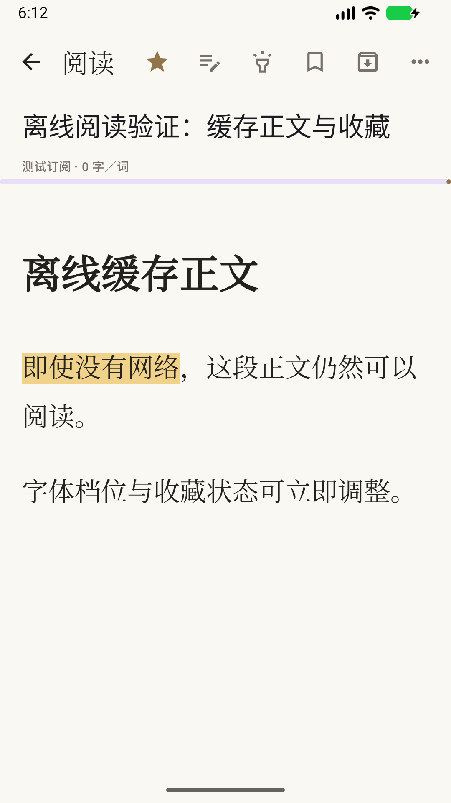
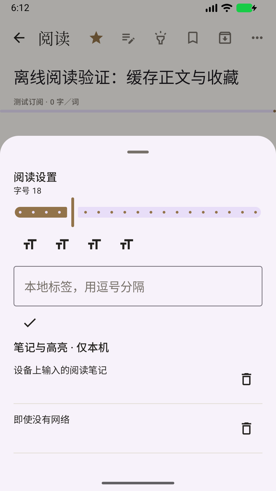

# Fluxa

**为专注阅读而设计的 Android RSS 阅读器。**

连接 NewsBlur，把订阅文章带到一个安静、简洁的阅读空间。缓存正文后，即使离线也能继续阅读。

[下载与版本](https://github.com/Vincent1993/fluxa/releases) · [反馈问题](https://github.com/Vincent1993/fluxa/issues) · [更新记录](CHANGELOG.md)

## 阅读，按你的节奏

- **订阅与离线阅读**：连接 NewsBlur 免费账号，添加 RSS 订阅，刷新和翻页获取文章，保留已缓存正文。
- **简洁的阅读体验**：纯图标操作、分段滑动手势、浅色与深色界面，以及可调字号与进度恢复。
- **随手整理**：标记已读、收藏、归档或留待稍后阅读；添加、编辑笔记与高亮，使用标签整理文章。
- **快速找到内容**：按订阅、阅读状态、标签、日期范围和关键词组合查找已缓存文章。
- **按需刷新**：手动刷新，也可选择开启后台刷新。

已读与收藏可以同步到 NewsBlur。笔记、高亮、标签、进度、归档和稍后读仅保存在当前设备。

## 阅读界面

 

界面截图使用离线示例文章。

## 下载与安装

正式签名安装包尚未发布。后续版本会在 [GitHub Releases](https://github.com/Vincent1993/fluxa/releases) 提供 APK、更新说明和校验文件。

想提前体验，可在最近一次成功的 [Android CI](https://github.com/Vincent1993/fluxa/actions/workflows/android-ci.yml) 中下载 `fluxa-debug-apk`，解压后安装 `app-debug.apk`。这是开发测试版，下载通常需要登录 GitHub；安装与升级注意事项见 [下载指南](docs/downloads.md)。

Preview 与正式版可同时安装，各自保留本地数据；安装与更新规则见 [下载指南](docs/downloads.md)。

## 开始使用

1. 准备 Android 8.0 或更新版本的设备，以及一个 [NewsBlur](https://www.newsblur.com/) 账号。
2. 安装 Fluxa，登录并添加 RSS 订阅。
3. 刷新文章，开始阅读；在断网时继续阅读已缓存的正文。
4. 按需要开启后台刷新，或用笔记、标签和稍后读整理阅读资料。

当前支持单个 NewsBlur 账号。远程图片与原文链接需要网络，本地搜索只覆盖已缓存内容。

## 反馈与参与

欢迎通过 [Issues](https://github.com/Vincent1993/fluxa/issues) 反馈问题或提出建议。开发与贡献说明见 [贡献指南](CONTRIBUTING.md) 和 [开发文档](docs/development.md)。

项目许可证尚未声明。

## 本轮整合范围（待 CI 验证）

本工作分支整合已公开快照 `30250d9844d70b56d9cbdd8c4133a38a6e75049e`：本地 RSS、订阅整理与离线策略、阅读器图片与段落交互、保存搜索条件、GitHub Library，以及本轮列表和阅读界面调整。保留 main 的 NewsBlur Room v4 迁移、本地笔记/高亮/标签/归档/稍后读与旧资料导入。

常规设备回归类由 `scripts/device-ci-classes.txt` 明确列出；截图及阅读图片交互用专用夹具初始化、验证并清理。未执行的真实账号联调、手工探针和人工 TalkBack 验收不计入通过结果。

测试预发布只交付 `com.fluxa.app.debug`，不覆盖稳定版包名。采用临时 Android Debug 签名，不保证不同构建之间可覆盖升级；不要因签名冲突直接卸载旧安装而丢失资料。通过全部验证后，预发布附实际构建 SHA、签名指纹、校验和与测试证据。此处配置及源码整合完成不等于构建或设备测试已经通过。
